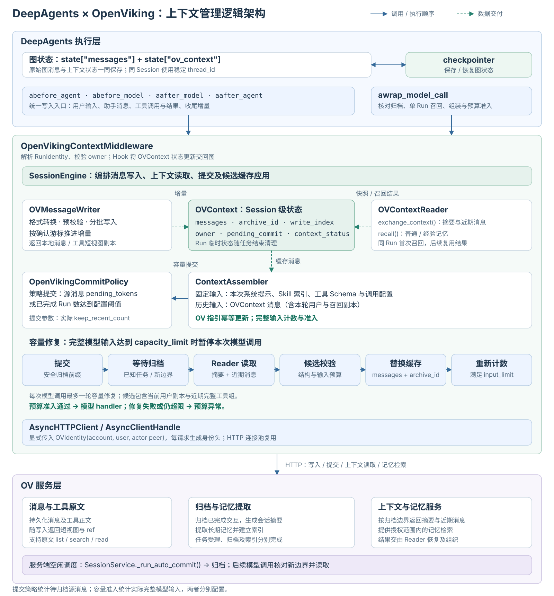
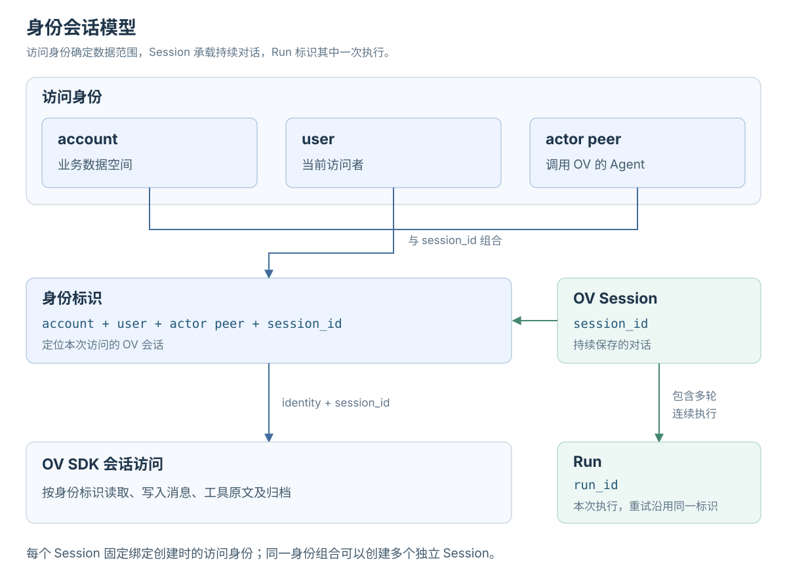
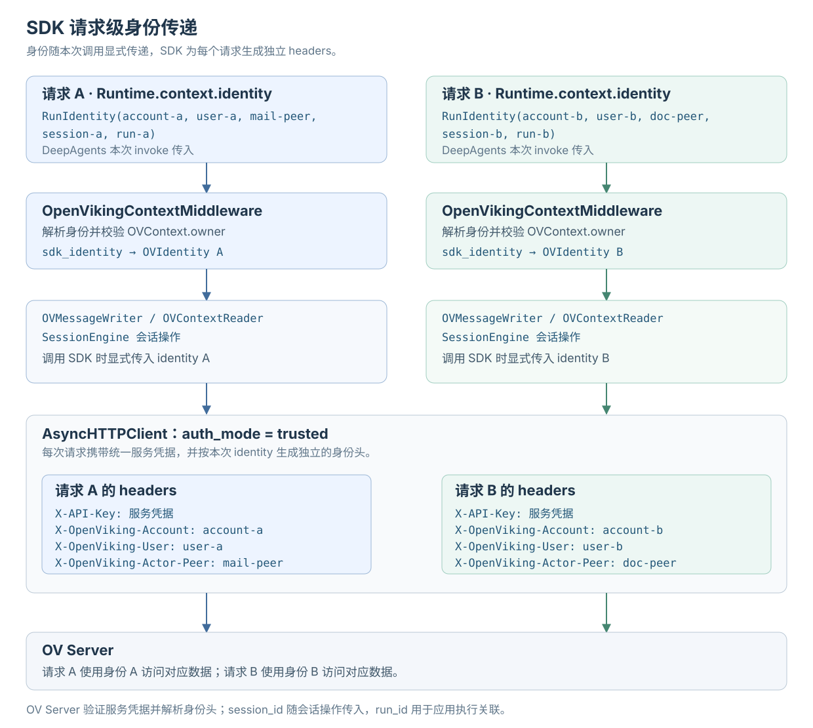
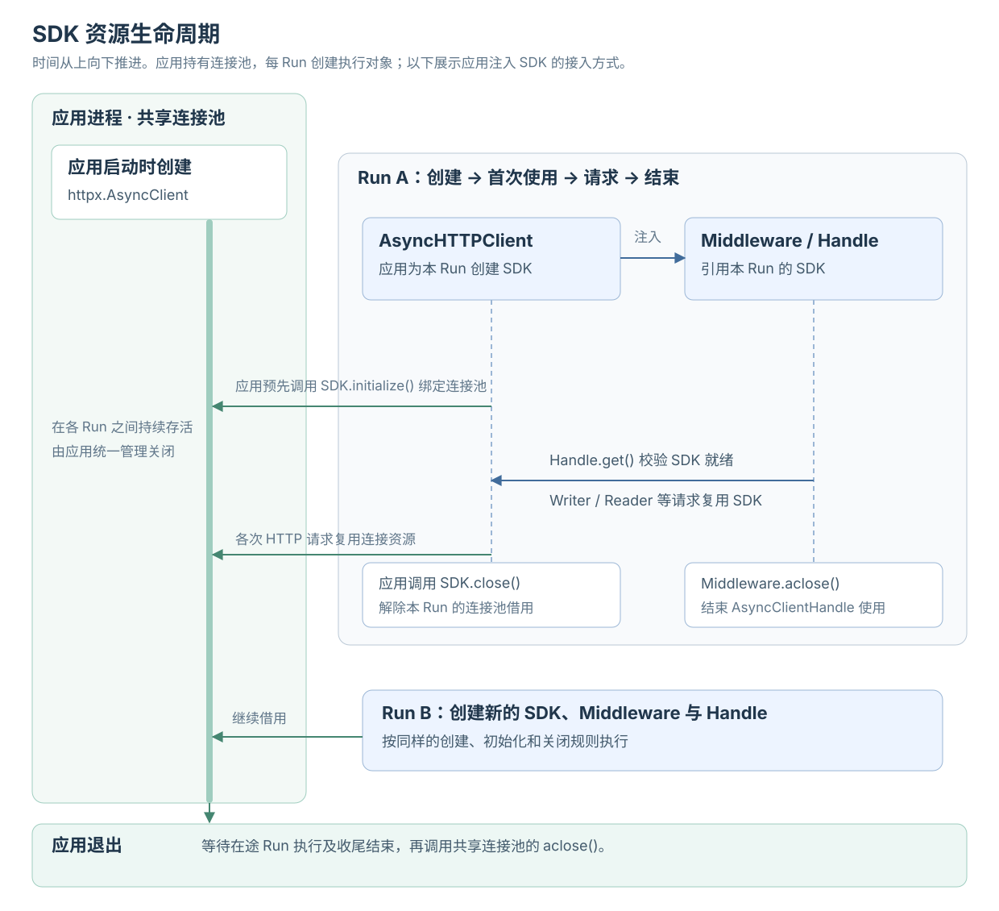
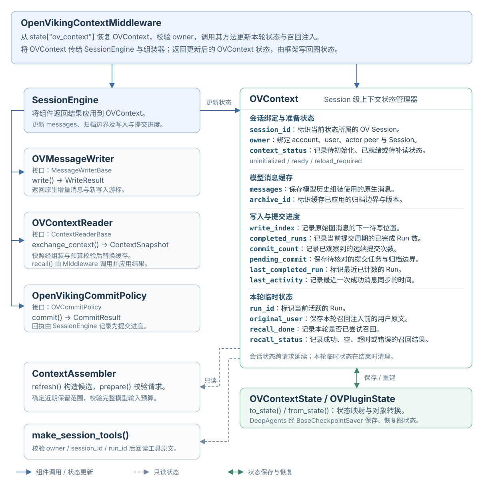
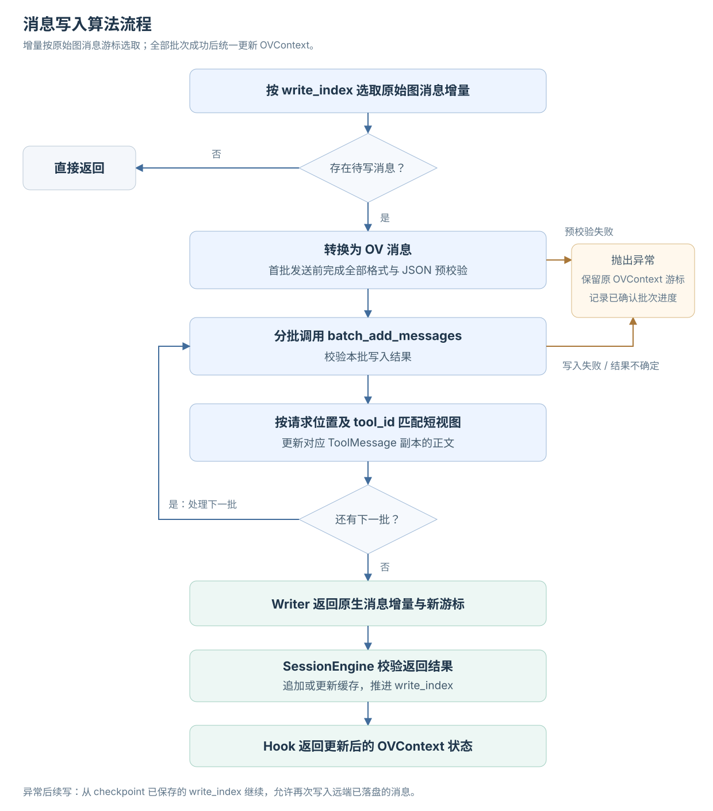
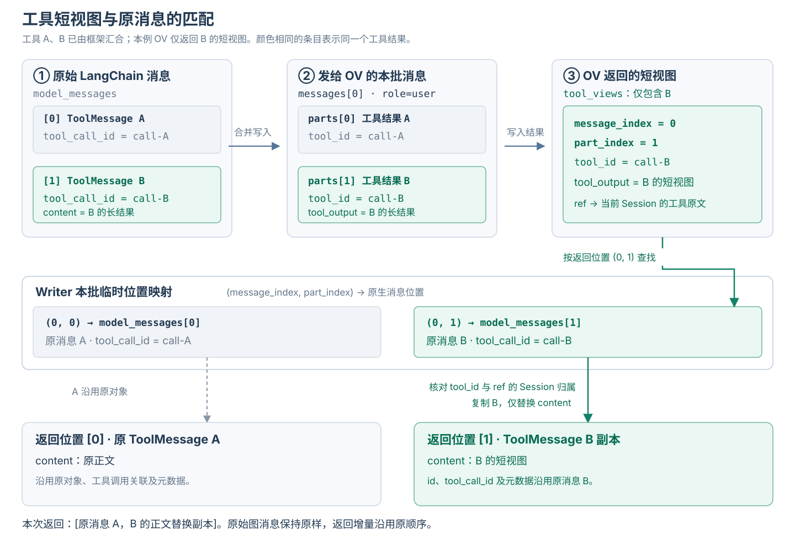
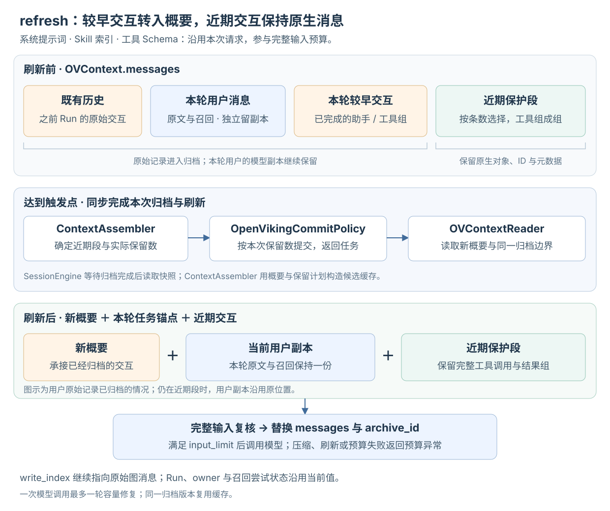
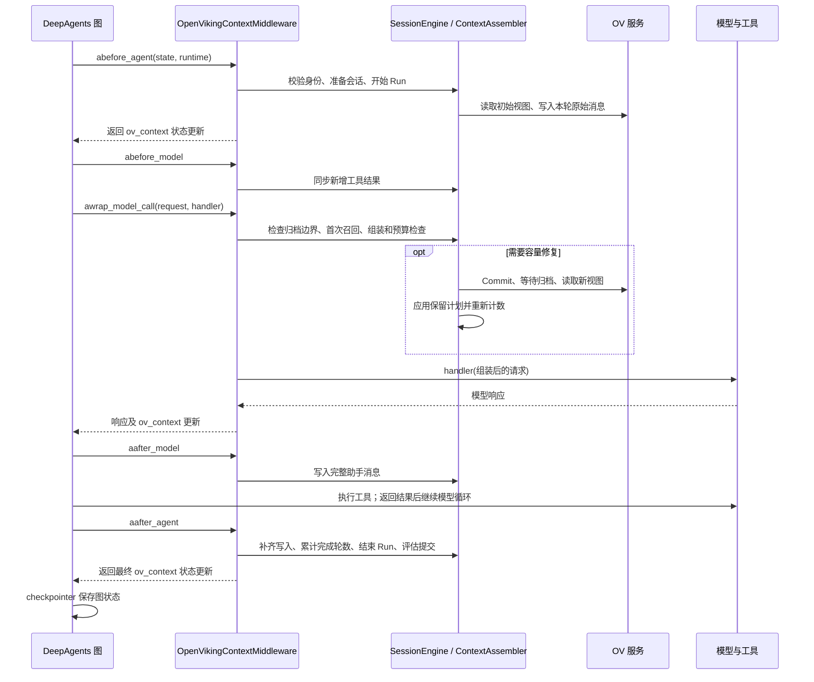

# OpenViking 接入 DeepAgents 实现上下文管理

`OpenVikingContextMiddleware` 通过 LangChain 异步 Middleware Hook 接入 DeepAgents，将原始消息持久化、工具结果短视图、会话摘要、长期记忆召回和模型输入预算纳入同一条执行链路。DeepAgents 调度模型与工具；OV 服务保存会话数据，执行归档、摘要生成、记忆提取与检索。

## 1. 整体架构



整体分为 DeepAgents 执行层、Middleware 上下文管理层和 OV 服务层。实线表示调用或执行顺序，虚线表示消息、短视图、摘要及召回结果的传递。

1. **DeepAgents 执行层**：`abefore_agent`、`abefore_model`、`aafter_model` 和 `aafter_agent` 将原始消息增量交给 Writer；`awrap_model_call` 在模型执行前核对归档边界，完成单 Run 召回、上下文组装及预算准入。原始 `messages` 与 `ov_context` 一同进入图状态，由 checkpointer 保存和恢复。
2. **Middleware 上下文管理层**：`SessionEngine` 协调 `OVMessageWriter`、`OVContextReader`、`OpenVikingCommitPolicy` 和 `ContextAssembler`。各模块围绕 Session 级 `OVContext` 交换消息增量、读取快照及提交进度；组装器将缓存消息与本次请求的系统提示、Skill 索引、工具 Schema 和调用配置组合，生成模型请求副本。
3. **OV 服务层**：保存消息和工具原文，返回带引用的工具短视图，执行归档、摘要生成、记忆提取与索引。服务端空闲调度独立发起提交；Middleware 在后续模型调用中核对归档边界并读取新视图。各操作通过共享 SDK，以本次请求的 `OVIdentity` 访问 OV。

应用在 Session 创建时确定有效配置，为各模块提供预算、超时、检索和提交参数。历史压缩由 OV 归档和上下文刷新链路管理，组装器负责模型输入的预算准入。

## 2. 身份与会话模型

### 2.1 身份层次



运行身份由 `RunIdentity` 统一表达：

| 标识 | 含义及生命周期 |
|---|---|
| `account_id` | account 数据空间标识 |
| `user_id` | account 内的 user 标识 |
| `actor_peer_id` | 本次调用 OV 的 Agent 身份 |
| `session_id` | 连续对话的 Session 标识，跨多个 Run 保持稳定 |
| `run_id` | 一次任务执行的标识，同一次执行的内部重试沿用 |

应用根据认证结果确定 account 和 user，根据 Agent 配置确定 actor peer，并校验 Session 的访问归属。每个 Session 固定绑定上述三项身份；同一身份组合可以创建多个独立 Session。

`RunIdentity.sdk_identity` 提取本次 SDK 调用使用的 `OVIdentity`；`session_key` 由 `(account_id, user_id, actor_peer_id, session_id)` 组成，用于校验缓存归属。单条消息的 `peer_id` 表示消息归属，与请求调用者 `actor_peer_id` 分别传递。

### 2.2 请求身份传递

1. 应用在 `ainvoke` / `astream` 的运行上下文中传入 `RunIdentity`。
2. Middleware 默认读取 `runtime.context.identity`，也可以通过 `identity_resolver(state, runtime)` 转换应用的上下文对象。
3. Middleware 校验字段及 Session、Run 绑定关系，恢复缓存的 `owner` 必须与本次 `session_key` 相同。
4. Reader、Writer、会话查询、提交和任务查询显式接收本次 `OVIdentity`；`SessionEngine` 在访问 OV 前再次校验其与缓存 owner 的一致性。

身份随调用传递，Agent 创建时配置的共享 SDK、Reader 和 Writer 可以服务多个身份。不同 Session 可以并发执行；同一 Session 的执行、取消清理和 checkpoint 写回由应用串行协调。

## 3. SDK 身份传递与资源生命周期

### 3.1 trusted 模式的请求级身份



SDK 与 OV Server 配套使用 `trusted` 认证模式。应用服务持有访问凭据，完成业务身份认证后，将本次 `OVIdentity` 传给 SDK；SDK 为每次请求生成身份请求头：

```text
X-API-Key                  服务访问凭据
X-OpenViking-Account        account_id
X-OpenViking-User           user_id
X-OpenViking-Actor-Peer     actor_peer_id
```

同一 SDK 和 HTTP 连接池可以承载不同身份的并发请求。身份头在请求作用域合成，共享客户端的默认头保持稳定。应用通过 Session 参数传递会话标识，`run_id` 用于应用执行与观测关联。

### 3.2 SDK 和连接池的管理



推荐由应用创建并初始化 `AsyncHTTPClient`，将其注入 Reader、Writer 和 Middleware。`AsyncClientHandle.get()` 校验借用客户端已初始化且连接可用；Run 结束释放本轮使用关系。应用待执行任务结束后依次关闭 SDK 和共享 HTTP 连接池。也可以为每个 Run 创建独立 SDK，借用应用级连接池，在 Run 结束时关闭该 SDK。

通过 URL 和服务凭据由 Handle 自建 SDK 时，Handle 负责初始化并关闭自己创建的 SDK；外部注入的 HTTP 连接池仍由应用管理。初始化锁仅协调 Handle 的 SDK 初始化过程，Session 执行顺序由应用管理。

## 4. OVContext 状态管理

### 4.1 管理范围



`OVContext` 是 Session 级上下文状态对象。Middleware 从图状态恢复它，`SessionEngine` 将写入、读取及归档结果应用到它，`ContextAssembler` 使用其中的消息构建模型输入。主要状态分为三组：

- **会话缓存**：`messages` 保存模型消息，`archive_id` 标识该缓存已应用的归档边界，`owner` 记录身份与 Session 绑定。
- **写入和提交进度**：`write_index` 记录原始图消息的已同步位置；`pending_commit` 记录已知提交任务；`commit_count` 记录已观察到的远端提交计数；`completed_runs` 和 `last_completed_run` 支持轮数策略及完成计数去重。
- **Run 临时状态**：`run_id`、`original_user`、`recall_done` 和 `recall_status` 记录当前任务、用户原文及召回尝试结果。

`context_status` 表达缓存可用性：`uninitialized` 表示尚待首次读取，`ready` 表示已获得可用视图，`reload_required` 表示后续需要补读远端上下文。

### 4.2 生命周期与 checkpoint

1. **首次执行**：Middleware 建立并校验 Session，读取 OV 初始视图，绑定 owner，开始本轮 Run。
2. **Run 内更新**：Writer 返回增量，Reader 返回快照；校验通过后更新缓存与进度，Hook 将 `OVContext.to_state()` 返回到图的 `ov_context` 字段。
3. **Run 正常结束**：恢复用户原文，清理召回标记和 Run 临时字段，保留会话缓存、归档边界和写入进度。
4. **Agent 实例重建**：应用继续使用同一 Saver 存储及 checkpoint 命名空间，以相同 `thread_id` 读取图状态，通过 `OVContext.from_state()` 重建状态对象。

`session_id` 标识 OV 会话；`thread_id` 标识 LangGraph 的 checkpoint 线程。应用为同一 Session 保持稳定映射，并保证不同身份与 Session 对应独立线程。采用全局唯一 Session 标识时可以直接复用；采用局部编号时，应结合 account、user 和 actor peer 构造线程键。

checkpointer 自动保存图状态中的 `ov_context`。应用负责配置 Saver 及其序列化和存储能力；运行时配置对象由应用另行保存。进程重启后继续任务时，应用先完成旧 Run 的恢复或结束处理，再创建新 Run。

## 5. 消息写入与工具短视图

### 5.1 写入时机

Writer 在本轮准备、助手与工具消息形成后以及任务收尾时，消费原始图消息中 `write_index` 之后的增量。写入成功并保存新游标后，后续调用继续处理新增消息。各阶段的调用顺序由 Hook 编排。

### 5.2 LangChain 到 OV 的格式转换

Writer 使用共享内容编解码函数转换实际发送的字段：

| LangChain 消息 | OV 写入形式 |
|---|---|
| `HumanMessage` | `role="user"`；正文转换为文本、图片等 `parts`；以 `message_kind="user_query"` 标记用户输入，携带可用的 `source_message_ids` |
| `AIMessage` | `role="assistant"`；正文转换为内容 Part，`tool_calls` 转换为待执行的 ToolPart，保留工具名称、参数及调用 ID |
| `ToolMessage` | `role="user"`；ToolPart 保存工具调用 ID、名称、参数、执行状态、输出正文及内容格式 |

例如，一次并行工具交互包含一条 `AIMessage(tool_calls=[A, B])` 和两条 `ToolMessage(tool_call_id=A/B)`。Writer 保留调用关联，并可将相邻工具结果合并为一个传输消息的多个 Part；OV 保存时按工具结果拆分为持久化记录。

Writer 接收框架聚合完成后的 `HumanMessage`、`AIMessage` 和 `ToolMessage`。流式 Chunk 在进入写入路径前完成聚合；系统提示词通过 `ModelRequest.system_message` 参与组装。召回注入副本、摘要和刷新锚点由上下文管理路径处理，写入来源保持为原始图消息。

本地消息的 `response_metadata`、`artifact` 等字段保留在原对象中。OV 写入协议保存正文及必要的关联字段；用户源消息 ID 通过专用字段传递，其余原生元数据的保留依赖本地消息及 checkpoint。

### 5.3 增量写入算法



1. 按原始图消息游标截取增量，校验支持的消息类型、工具调用关联和内容格式。
2. 转换整段增量，使用严格 JSON 序列化预校验真正发送的 payload，提前拦截 `NaN`、`Infinity` 等值。
3. 按 `batch_size` 顺序调用 `batch_add_messages`，每批最多 100 条传输消息。
4. 校验 Session 和数量回执，解析本批 `tool_views`，构造供 OVContext 追加的原生消息增量。
5. 全部批次成功后返回 `WriteResult`，由 `SessionEngine` 合并缓存并推进 `write_index`。

三个计数分别使用各自坐标：`write_index` 对应原始图消息位置，`message_index + part_index` 对应本批传输位置，数量回执对应 OV 持久化消息数量。工具结果聚合后，这些数值可以不同。

`pending_tokens` 回执存在时用于后续提交判断。`tool_views` 为可选回执；缺少短视图时使用原工具消息。普通消息复用原对象；压缩结果通过复制 `ToolMessage` 并替换 `content` 返回，原始图消息保持完整。

分批写入中途失败时，Writer 通过 `IncompleteWriteError` 携带已确认前缀，本次调用保持原缓存和游标。OV 已写入而 checkpoint 尚未保存的进程退出窗口采用既有游标恢复，可能重复写入；该边界遵循至少一次写入语义。

### 5.4 并行工具结果的短视图关联



Writer 为每个工具结果建立临时位置映射。收到 `tool_views` 后，先用 `message_index + part_index` 定位本地 `ToolMessage`，再核对 `tool_id` 和原文引用所属 Session。映射仅在当前批次内有效，处理后释放。

这种关联方式支持同一助手消息并行调用多个工具，也支持超过 100 条消息的分批写入。每批的位置从本批重新计算，短视图只替换对应工具结果。可选短视图回执无效时记录告警，并沿用该工具的原始正文。

### 5.5 原文回读与系统指引

系统提示词中的 `[OpenViking Context Guide]` 说明：带有 `[OpenViking tool result externalized]` 标记的正文是短视图；摘要、结构和样本用于快速理解结果。需要精确内容、完整列表或遗漏细节时，模型按 `ref` 回读；已有信息足够时直接使用。

| 工具 | 参数及行为 |
|---|---|
| `openviking_tool_result_list` | 列出当前 Session 的原文引用，`limit` 为 1–50 |
| `openviking_tool_result_search_many` | 接收 `ref` 和包含 1–4 个关键词的 `queries` JSON 数组；按 OR 语义搜索，`limit` 为每个关键词 1–20 条命中 |
| `openviking_tool_result_read` | 按 `ref`、非负字符 `offset` 和 1–20000 的字符 `limit` 读取正文 |

搜索工具合并重复命中窗口，返回字符偏移，单次搜索正文最多 6000 字符；`partial` 标记结果截限。工具从运行上下文取得身份和 Session，模型只提供引用与查询范围。回读片段作为新的工具消息参与后续组装和预算计数。

## 6. Commit 提交与归档进度

### 6.1 提交条件

`OpenVikingCommitPolicy` 接收 OV 的待归档 `pending_tokens` 和本地已完成轮数，支持以下触发方式：

- **策略提交**：待归档 Token 达到 `token_budget × commit_token_threshold_ratio`，或完成轮数达到 `completed_run_threshold` 且存在待归档内容。
- **容量提交**：完整模型输入达到压缩触发条件，由组装器生成可安全归档的前缀后发起。

OV 服务端的空闲提交由 `SessionService._run_auto_commit()` 调度。它依据服务端配置判断空闲条件并发起归档；Middleware 通过后续归档边界检查衔接新的会话视图。

`keep_recent_count` 控制 Run 内压缩的近期保留起点。正常 Run 结束后，Hook 完成临时状态清理，按 `keep_recent_count=0` 评估提交。本轮完成数通过 `last_completed_run` 去重，成功归档后重置相应累计进度。

### 6.2 提交、归档和读取的关系

提交回执、归档完成、摘要应用和长期记忆检索分别对应不同阶段：

1. **提交受理**：OV 返回任务与归档信息，`pending_commit` 保存已知任务标识和边界。
2. **归档执行**：OV 异步处理源消息，生成摘要并执行后续记忆提取。
3. **就绪确认**：`SessionEngine` 查询已知任务及 Session 元数据，结合提交计数和已结束归档边界判断可读取状态。
4. **视图应用**：Reader 返回新快照，缓存通过完整性及预算校验后切换 `archive_id`，清理对应提交进度。

归档编号按数值顺序比较，已应用边界保持单向前进。长期记忆的生成和索引状态由 OV 负责，应用可通过后续检索验证可用性。

### 6.3 提交进度恢复与不确定结果

已保存的 `pending_commit.task_id` 用于查询在途任务。任务明确失败或取消时，保留当前缓存与写入游标，清理对应在途标记并返回异常；已知归档就绪时继续刷新视图。

Commit 只对能够确定尚未发送的连接建立错误执行自动重试。请求发送后结果未知时向上传播，由应用核对 OV 状态，避免重复提交。跨进程恢复依赖 checkpoint 保存的已知进度和 OV 的持久化状态；引擎进程内的临时记录随实例释放。

## 7. 上下文读取与记忆召回

### 7.1 会话视图读取

`OVContextReader.exchange_context()` 根据 Session、请求身份和历史预算调用 `get_session_context`，从同一份响应取得：

- `messages`：预算内的近期 OV 消息。
- `latest_archive_overview`：可用历史摘要。
- `latest_finished_archive_id`：服务端已结束的归档边界。

Reader 通过 `restore_messages()` 恢复 `HumanMessage`、`AIMessage` 和 `ToolMessage`，还原工具名称、参数、调用 ID 及结果。存在摘要时，在消息前部添加 `[Session History Summary]` 消息，并以 `ov_summary:<archive_id>` 标识该视图中的摘要。

带单一源 ID 的用户输入恢复原始用户 ID，其余消息使用 OV 记录 ID，必要时结合工具调用 ID 区分。恢复后的消息保留 OV 记录关联信息，供缓存替换与工具配对校验使用。

服务端按“完整摘要 + 近期消息”组织读取预算，近期消息的截取保持工具调用与结果完整。摘要自身超过历史额度时返回 `ContextHistoryBudgetError`。`SessionEngine` 校验响应边界、消息 ID 和工具配对后，才将新快照应用到缓存。

`latest_finished_archive_id` 表示已结束的归档边界。某次归档失败时，该边界可能配合此前成功生成的摘要返回，调用方同时结合任务状态识别本次提交结果。

### 7.2 长期记忆检索

长期记忆与当前 Session 的摘要分别管理。Reader 使用本轮用户原文构造检索请求，检索范围由 `MemoryReaderConfig` 和服务端策略共同确定；配置 user 或 peer 记忆范围时，可以召回同一授权范围内其他 Session 提取的记忆。

Reader 提供两种检索执行方式：

1. **context 模式**：调用 `search(mode="context")`，由 OV 服务端执行过滤、排序、类型配额、预算控制和内容组织。
2. **find 模式**：按配置的目标路径并发查询，在 Reader 中完成合并去重、排序、正文读取和预算分配。

普通记忆与经验记忆分别配置启用范围及额度。召回限制包含候选数量、最终注入数量、内容预算和超时；检索与后续正文读取共享本次召回的截止时间。

### 7.3 单 Run 召回与注入

本 Run 首次模型调用执行一次召回尝试。成功、空结果、超时或读取错误都会记录 `recall_done` 和对应结果，后续工具循环沿用本次结果，下一个 Run 重新召回。

文本用户消息按以下形式生成模型侧副本：

```text
[参考记忆]
召回的事实、偏好或经验

[用户原文]
本轮原始请求
```

多模态消息在内容块前插入参考文本，保留原内容块。副本保留用户消息 ID，并标记召回注入状态；Writer 继续读取原始图消息，因此召回参考和合成摘要通过模型缓存参与推理。工具实际输出则写入 OV，供原文回读。

可选召回的非鉴权失败返回空召回结果，模型继续执行；鉴权失败向上传播。超时后到达的结果丢弃，避免在本 Run 中途改变记忆视图。

## 8. 上下文组装与预算管理

### 8.1 模型输入顺序

组装器基于本次 `ModelRequest` 构建副本，保留模型、工具定义和调用配置。消息排列如下：

```text
ModelRequest
├── system_message
│   ├── 应用系统提示词
│   ├── DeepAgents 指引、工具使用说明、Skill 索引与规则
│   └── [OpenViking Context Guide]
├── tools / tool_choice / response_format / model_settings
│   └── 工具名称、描述、参数 JSON Schema 及本次调用配置
└── messages：来自 OVContext 的模型消息副本
    ├── [Session History Summary]：已有历史摘要
    ├── 保留的历史用户、助手和工具消息
    ├── 本轮用户消息：[参考记忆] + [用户原文]
    └── 本轮保留的助手消息、工具调用和工具结果
```

系统消息沿用框架已形成的内容顺序；组装器通过位置与内容标记追加或更新同一份 OV 指引，使重复组装保持幂等。工具 Schema 作为请求参数提供。Skill 索引和使用规则进入系统消息，模型按需读取的 `SKILL.md` 正文作为工具结果进入后续历史。

历史消息保持交互顺序。摘要衔接已归档历史，召回提供任务参考，当前用户副本保留一份；用户原文在 Run 结束时恢复。

### 8.2 预算定义

设模型总窗口为 `W`、输出预留为 `O`、安全余量为 `S`，预算关系如下：

```text
input_limit = W - O - S
存在独立输入上限 max_input_tokens 时：
input_limit = min(W - O - S, max_input_tokens)

base_context_limit = floor(W × base_context_ratio)
capacity_limit = floor(W × capacity_ratio)
history_target_tokens = max(0, base_context_limit - fixed_tokens)

base_context_limit < capacity_limit < input_limit
```

- **基础上下文目标**用于分配摘要和历史的读取额度。`fixed_tokens` 通过清空请求的消息列表、保留系统消息及调用配置计算，包含 OV 指引、工具 Schema 和结构化输出配置等固定开销。本轮用户输入与召回内容在最终完整输入中计数。
- **压缩触发阈值**用于判断何时暂停模型调用，执行提交和历史刷新。
- **输入准入上限**用于最终放行模型请求，预留生成输出及安全余量。

默认 `base_context_ratio=0.3`、`capacity_ratio=0.9`、`output_reserve=4096`、`safety_margin=512`。例如显式配置 `W=256000` 时，基础目标为 76800，压缩触发值为 230400，输入上限为 251392；这些数值仍需结合实际模型能力和调用配置设置。

Reader 的历史额度覆盖完整摘要及近期消息。召回模块执行独立记忆预算，其实际注入内容计入完整输入。Commit 的 `token_budget` 衡量待归档源消息，与模型完整输入采用不同统计范围，应分别配置。

### 8.3 输入估算

`ApproximateTokenCounter` 优先使用模型适配层提供的请求载荷及用量估算能力；通用路径使用共享文本估算器。其文本权重公式为：

```text
T_text = ceil(0.25 × N_other_BMP + 1.5 × N_CJK + 2 × N_other_non_BMP)
```

其中三类字符互斥计数：CJK 字符按 1.5，其他基本多文种平面字符按 0.25，其余补充平面字符按 2。完整请求在文本基础上计算消息封装、图片及工具/结构化配置等开销；默认图片估值为每张 1024 Token，应用可注入与模型匹配的计数器。

计数覆盖系统提示、摘要、历史、本轮输入、召回、工具调用与结果、图片、工具 Schema 和输出格式配置。短视图和回读片段均按实际进入模型的内容计数。预算估算用于准入控制，模型返回的 usage 用于实际 Token 消耗统计。

### 8.4 压缩保留范围与缓存切换



`ContextAssembler.plan_refresh()` 根据缓存生成保留计划：

1. 单独保留本轮用户消息副本，包括已注入的召回内容。
2. 以 `keep_recent_count` 选择近期尾部，保留当前 Run 最新的助手交互，并向前扩展边界以覆盖完整工具调用与结果组。
3. 将其余已完成交互划入归档范围，包括先前 Run 和当前 Run 较早的交互。

例如最新助手消息并行调用两个工具，保留范围至少覆盖该助手消息及两个结果。配置条数是选择起点，实际条数由完整交互边界确定。

归档完成后，候选缓存由“新摘要 + 计划保留消息 + 提交期间成功追加的消息”组成。当前用户消息已在候选中时替换其对应副本，否则在摘要后补入一次。候选同时校验源 Run、归档边界、游标、消息唯一性、工具配对及输入预算。

候选校验成功后统一更新 `messages` 和 `archive_id`。`write_index` 继续对应原始图消息列表，缓存压缩不会重定义该游标。

### 8.5 同步压缩与重新准入

1. 计算历史额度，读取或刷新上下文，组装最终请求。
2. 完整输入达到 `capacity_limit` 或触发输入预算异常时，以 `capacity` 原因请求 Commit；复用已知在途提交，等待归档就绪。
3. Reader 读取新视图，组装器应用保留计划并重新计数。每次模型调用最多执行一轮容量修复。
4. 最终输入满足 `input_limit` 后执行模型；提交失败、等待超时、读取失败或修复后仍超限，返回预算异常。鉴权和取消异常沿用其原有类型。

`commit_wait_timeout` 默认 300 秒，约束等待归档及刷新过程。读取降级得到的缓存仍执行完整输入准入检查。

## 9. 配置、异常与观测

### 9.1 配置生效范围

| 配置对象 | 控制范围 |
|---|---|
| `OVContextConfig` | 模型窗口、输出预留、输入预算比例、上下文读取策略、等待及重试 |
| `MemoryReaderConfig` | 读取预算、检索模式、记忆范围、数量、类型预算及超时 |
| `CommitConfig` | 源消息预算、提交比例、轮数阈值、近期保留条数 |
| `WriterConfig` | 批次大小、消息归属 peer 和工具回读保护配置 |

应用加载环境文件或进程环境，将值转换为配置对象。在 Session 创建时保存完整有效配置；后续 Run 以该配置重新构造执行组件。修改配置时创建新 Session，使缓存、预算和检索策略保持一致。

checkpoint 保存 `OVContext` 运行状态；配置快照、凭据和 SDK 资源分别由应用管理。

### 9.2 异常处理

- **上下文读取**：`context_failure="raise"` 时返回读取异常；`"host"` 时允许指定读取失败沿用现有缓存并置为 `reload_required`，后续尝试补读。完整摘要超出预算时返回预算相关错误。
- **可选记忆召回**：非鉴权的检索失败或超时按空结果继续，本 Run 记录已尝试召回。
- **身份、会话及必需写入**：校验失败或必需操作失败返回异常。鉴权失败和取消沿执行链路传播。
- **重试**：`retry_attempts` 表示首次调用后的额外次数，0 表示执行一次。读取按暂态错误判断；写入根据已确认结果及发送阶段限制重试；Commit 仅对能够确定尚未发送的连接建立错误执行自动重试。
- **输入准入**：正常、读取降级及压缩刷新路径统一检查最终输入，超限通过预算异常返回。

### 9.3 结构化观测

`Metrics` 为写入、读取、召回、组装、提交和等待等阶段输出结构化事件，携带 Session / Run 身份、耗时、状态和对应计数。应用可注入同步、非阻塞 sink，将事件统一保存为 JSONL 或接入日志平台；默认实现输出日志。

| 事件示例 | 主要观测内容 |
|---|---|
| `before_agent.total` | 本轮准备耗时与结果 |
| `message.write` | 写入耗时、成功消息数量及错误状态 |
| `memory.recall` | 召回耗时、状态及命中情况 |
| `context.assemble` / `context.estimate` | 组装耗时、完整输入估算及各预算阈值 |
| `context.commit` / `context.compress_wait` | 提交与归档等待耗时、任务及归档关联 |
| `context.compression` | 缓存切换前后的消息数、正文字符数及字符压缩率 |
| `model.handler` | 模型执行耗时和成功、异常或取消状态 |

预算估算通过模型调用元数据传递。应用可使用框架回调记录实际模型输入及返回的 usage，并以每次模型调用的回调 ID 作为 `model_call_id` 关联；任务级 `RunIdentity.run_id` 用于聚合同一任务的多次模型调用。流式统计以完整调用结果去重累计实际用量。

sink 抛出异常时，Middleware 记录 `metrics_sink_failed` 告警及错误栈，主执行链路继续。应用持久化日志时配置访问控制、内容脱敏和保留周期。

## 10. Hook 编排与状态写回

上述模块通过五个异步 Hook 组合。下面以一次用户输入、一次工具交互为例：



| Hook | 组合的功能及结果 |
|---|---|
| `abefore_agent` | 解析身份，恢复 OVContext，准备 Session，绑定 Run，写入用户输入并返回状态 |
| `abefore_model` | 将新增工具消息写入 OV、合并缓存，评估适用的策略提交 |
| `awrap_model_call` | 检查可用归档、单 Run 召回、组装输入、执行容量修复和准入，再调用模型 handler |
| `aafter_model` | 写入完整助手消息及工具调用，按响应阶段评估提交 |
| `aafter_agent` | 补齐消息、去重累计完成轮数、清理 Run 临时状态并评估结束阶段提交 |

普通 Hook 通过返回字典更新 `state["ov_context"]`；模型包装路径通过响应携带的 `Command` 返回同一字段的更新。LangGraph 将更新应用到图状态，再由 checkpointer 持久化。应用保持同 Session 的结束清理、状态写回和下一次执行有序衔接。
